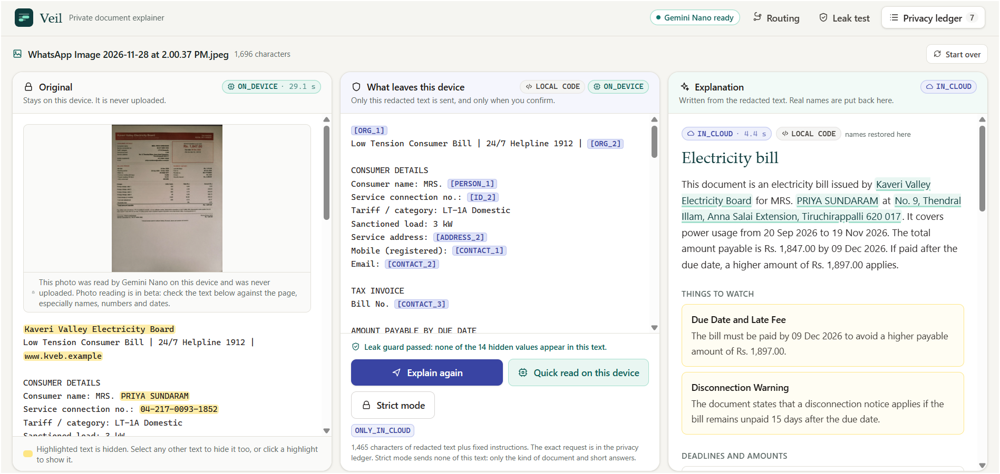

# Veil

[](https://github.com/venki-byte/veil/actions/workflows/ci.yml)
[](https://opensource.org/licenses/Apache-2.0)

**Understand the paperwork. Keep the personal details.**

Veil is a Chrome web app that explains sensitive paperwork (lab reports, rental and loan
agreements, bank and tax letters) in plain language, without the personal details ever
leaving your device.

Built for #BuildHybridAI 2026 with **Firebase AI Logic** and the **Hybrid Inference SDK**.

> Veil explains documents. It does not give medical, legal or financial advice.

**Try it:** https://buildhybrid-6c4e8.web.app (Chrome on desktop; see [Requirements](#requirements))

<!-- TODO before submitting: add the demo video link here. -->

### Screenshots

A PDF blood report (invented patient). The original stays on the device, the middle column is all the cloud receives, and the right column is the explanation with the real names put back:


A photo of a printed electricity bill (invented customer), read on the device by Gemini Nano:



## The problem

A cloud chatbot would explain your blood test or loan letter well. But pasting it in means
sending names, addresses, ID numbers and health details to a server. Many people either
avoid AI for these documents or share more than they should.

## How Veil works

1. **Your device reads the document.** Gemini Nano, running inside Chrome, finds names,
   addresses, IDs and other personal details. Plain code replaces each one with a typed
   placeholder such as `[PERSON_1]`.
2. **The cloud explains the redacted text.** You see exactly what will be sent and can change
   it. A leak guard blocks the request if any hidden value is still in it. Cloud Gemini only
   ever sees placeholders.
3. **Your device puts the names back.** The answer comes back with placeholders. Plain code in
   the browser tab restores the real values for display.

The app shows three columns side by side:

| Column | What it shows |
| --- | --- |
| **Original** | Your document. It never leaves the device. Hidden details are highlighted. |
| **What leaves this device** | The redacted text, exactly as it would be sent, with a switch for every hidden detail. |
| **Explanation** | A summary, things to watch, deadlines and amounts, key terms and questions to ask, with real names restored locally. |

## Why hybrid

In Veil the device/cloud split is the privacy mechanism itself, not a fallback. All four
Firebase AI Logic inference modes are used, each for a stated reason:

| Mode | Used for | Why |
| --- | --- | --- |
| `ONLY_ON_DEVICE` | Transcribe a photo; detect personal details (two narrow passes); strict mode's local steps | Raw data must never leave. If Gemini Nano is missing, Veil fails visibly rather than leak. |
| `ONLY_IN_CLOUD` | Full explanation of the redacted text; strict mode's two cloud steps | Needs strong reasoning and long context. The input is already redacted and has passed the leak guard. |
| `PREFER_ON_DEVICE` | Quick read, simpler words, explain a term, translate | The input is already redacted, so either path is safe; local is free and instant. |
| `PREFER_IN_CLOUD` | Follow-up questions | Best quality when online; still answers from the device when offline. |

The routing table lives in one place, [`src/ai/hybrid.ts`](src/ai/hybrid.ts), next to the
code that enforces it.

### Routing you can see

- **Source badges.** Every result carries a badge showing where it actually ran, read from
  `response.inferenceSource`: `ON_DEVICE`, `IN_CLOUD`, or `LOCAL CODE` for steps with no
  model at all.
- **Privacy ledger.** A drawer listing every model call in the session: the task, the mode
  requested, where it ran, how long it took, and the exact text sent to the cloud (or
  "nothing left this device").
- **Routing check** (`#/routing`). Runs one harmless call in each of the four modes on your
  own machine and shows where each ran, plus a live leak guard demonstration.

## Strict mode

For the most sensitive documents, the cloud never sees the document at all, not even
redacted:

1. **On-device:** Gemini Nano names the kind of document, choosing from a fixed list of
   twelve labels ("loan document", "blood test or lab report", and so on).
2. **Cloud:** sees only that label and writes up to ten questions to ask about such a
   document.
3. **On-device:** Gemini Nano answers the questions from the document, chunk by chunk.
4. **Cloud:** writes the explanation from those short, redacted answers.

Hard limits in plain code bound what can reach the cloud: the label must be exactly one of
the twelve (anything else becomes "other document"), there are at most ten questions, and
each combined answer is capped at 300 characters, redacted again, and checked by the leak
guard. The explanation panel lists exactly what the cloud received in place of the document.
After a strict mode run, follow-up questions are answered on-device, so the document still
never leaves.

Strict mode trades some quality for privacy: the explanation is built from less
information, so it can be thinner than the standard one.

## Measured, not claimed

The **leak test** (`#/eval`) runs synthetic documents with planted personal details through
pattern matching alone and through pattern matching plus Gemini Nano. Scoring is plain code
and is done by position: a planted detail counts as hidden only if every letter and digit of
every occurrence would be replaced by a placeholder. If any part would still be visible to
the cloud, it counts as leaked.

There are two sets of ten documents. The **development set** was used to improve detection.
The **held-out set** was written afterwards and is never used to tune anything, so its number
is the honest one. With Gemini Nano, each run scores one on-device pass and two passes from
the same calls, so the effect of the second pass is measured, not assumed.

**First run** (Chrome 158 on Windows, Gemini Nano, 2026-11-20). 70 planted details in ten
documents; 8.1 seconds per document with Gemini Nano:

| Document | Planted details | Leaked: regex only | Leaked: regex + Gemini Nano | Time: regex + Nano |
| --- | ---: | ---: | ---: | ---: |
| Liver function test | 6 | 1 | 0 | 6.7 s |
| Hospital discharge summary | 6 | 2 | 0 | 11.6 s |
| Doctor's travel certificate | 6 | 2 | 0 | 8.3 s |
| Rent agreement | 10 | 5 | 0 | 8.2 s |
| Personal loan sanction letter | 9 | 1 | 0 | 10.0 s |
| Bank KYC reminder | 6 | 3 | 0 | 9.0 s |
| Income tax notice | 5 | 1 | 0 | 4.2 s |
| Health insurance claim letter | 7 | 1 | 0 | 13.2 s |
| Employment offer letter | 8 | 5 | 4 | 5.6 s |
| Legal notice for a bounced cheque | 7 | 4 | 1 | 4.4 s |
| **Total (10 documents)** | **70** | **25 (35.7%)** | **5 (7.1%)** | **8.1 s per document** |

Pattern matching alone left about a third of the planted details visible; adding Gemini Nano
brought that to about 7%. The five that Gemini Nano still missed were two unlabelled
addresses, a company name and two people's names written inside sentences.

**What the first run exposed, and what changed.** The same run, on a whole sample lab report,
showed that an unlabelled street address was not hidden, and that the cloud sometimes copied an
example placeholder (`[ORG_1]`) from the prompt into its answer. Both were fixed afterwards:
a pattern for addresses that end in a PIN code, a pattern for company names with a legal
suffix ("... Private Limited"), and prompts that list only the placeholders actually present
in the text. With those patterns, **pattern matching alone** now leaks 17 of 70 (24.3%) on the
development set; this number is deterministic and is checked by the unit tests.

Because names written inside sentences were Gemini Nano's main miss, detection now asks it two
narrow questions per chunk instead of one broad one: first every personal detail, then only the
names of people and organisations. This follows the finding that small models do best on
narrow jobs over short text.

**Runs of both sets, one pass versus two** (Chrome 158 on Windows, Gemini Nano). Gemini
Nano does not give exactly the same answer every time, so every clean run is shown, not the
best. The held-out set is the fair estimate. The 2026-11-22 runs were on the hosted site. A
first hosted attempt that day is left out because its on-device calls stalled and timed out
(7 failed calls), which would make the numbers unfair; the rerun had no failed calls.

| Set | Run | Planted details | Leaked: regex only | Leaked: + Gemini Nano, 1 pass | Leaked: + Gemini Nano, 2 passes |
| --- | --- | ---: | ---: | ---: | ---: |
| **Held-out (never tuned on)** | 2026-11-20 | 61 | 29 (47.5%) | 7 (11.5%) | **2 (3.3%)** |
| **Held-out (never tuned on)** | 2026-11-21 | 61 | 29 (47.5%) | 10 (16.4%) | **3 (4.9%)** |
| **Held-out (never tuned on)** | 2026-11-22, hosted site | 61 | 29 (47.5%) | 7 (11.5%) | **2 (3.3%)** |
| Development (tuned on) | 2026-11-20 | 70 | 17 (24.3%) | 5 (7.1%) | 1 (1.4%) |
| Development (tuned on) | 2026-11-21 | 70 | 17 (24.3%) | 1 (1.4%) | 0 (0.0%) |
| Development (tuned on) | 2026-11-22, hosted site | 70 | 17 (24.3%) | 0 (0.0%) | 0 (0.0%) |

Across both runs, the second, narrow pass cut held-out leaks by about three quarters (from 7
and 10 to 2 and 3), at a cost of about 4 more seconds per document. The details still
visible on the held-out set were a vehicle registration number, a flat number and a first
name used on its own. Per document, first run:

<details>
<summary>Held-out set, per document</summary>

| Document | Planted details | Leaked: regex only | Leaked: + Gemini Nano, 1 pass | Leaked: + Gemini Nano, 2 passes | Time: 2 passes |
| --- | ---: | ---: | ---: | ---: | ---: |
| Dental treatment estimate | 7 | 3 | 2 | 0 | 11.6 s |
| School fee reminder | 7 | 1 | 0 | 0 | 13.3 s |
| Electricity disconnection notice | 6 | 4 | 0 | 0 | 7.3 s |
| Car insurance renewal notice | 6 | 4 | 1 | 1 | 5.1 s |
| Credit card payment reminder | 4 | 3 | 1 | 0 | 5.5 s |
| MRI report | 7 | 2 | 1 | 0 | 6.5 s |
| Employment warning letter | 5 | 3 | 0 | 0 | 7.3 s |
| Housing society dues notice | 6 | 3 | 2 | 1 | 7.1 s |
| Summons in a civil suit | 4 | 4 | 0 | 0 | 7.7 s |
| US hospital bill | 9 | 2 | 0 | 0 | 18.0 s |
| **Total (10 documents)** | **61** | **29 (47.5%)** | **7 (11.5%)** | **2 (3.3%)** | **8.9 s per document** |

</details>

<details>
<summary>Development set, per document</summary>

| Document | Planted details | Leaked: regex only | Leaked: + Gemini Nano, 1 pass | Leaked: + Gemini Nano, 2 passes | Time: 2 passes |
| --- | ---: | ---: | ---: | ---: | ---: |
| Liver function test | 6 | 1 | 0 | 0 | 6.8 s |
| Hospital discharge summary | 6 | 1 | 0 | 0 | 8.4 s |
| Doctor's travel certificate | 6 | 2 | 1 | 0 | 21.3 s |
| Rent agreement | 10 | 3 | 0 | 0 | 21.6 s |
| Personal loan sanction letter | 9 | 1 | 1 | 0 | 340.3 s |
| Bank KYC reminder | 6 | 3 | 1 | 1 | 12.7 s |
| Income tax notice | 5 | 0 | 0 | 0 | 6.1 s |
| Health insurance claim letter | 7 | 1 | 1 | 0 | 9.2 s |
| Employment offer letter | 8 | 3 | 1 | 0 | 11.0 s |
| Legal notice for a bounced cheque | 7 | 2 | 0 | 0 | 8.1 s |
| **Total (10 documents)** | **70** | **17 (24.3%)** | **5 (7.1%)** | **1 (1.4%)** | **44.6 s per document** |

</details>

On the personal loan letter, one on-device call ran away and wrote until it hit the model's
output limit, taking 338 seconds; that is what inflates the development-set average. The
second pass still covered that document, so no detail leaked. Each on-device detection call
now has a 90-second limit, so a runaway call is stopped and counted as a failure instead. In
the second run no call failed, and the two-pass averages were 10.4 seconds per document on the
held-out set and 12.7 on the development set.

Be careful how you read these numbers. The development-set figures are likely to be
optimistic, because patterns were added after seeing which of those details were missed. The
held-out figures are the fairer estimate. The documents and their planted details are in
[`src/features/eval/corpus.ts`](src/features/eval/corpus.ts) and
[`src/features/eval/heldout.ts`](src/features/eval/heldout.ts). Every person, organisation,
address and number in them is invented. Twenty documents is a small sample: treat the
results as an indication, not a guarantee.

## What makes it trustworthy

- **One door to the models.** [`src/ai/hybrid.ts`](src/ai/hybrid.ts) is the only file that
  imports `firebase/ai`. Inference, the model download and the model status all go through
  the SDK. There are no direct Prompt API calls and no direct Gemini API calls anywhere in
  the app, and the Gemini API key is never in this code; Firebase AI Logic holds it.
- **The leak guard is structural.** Any call that could reach the cloud must hand the
  wrapper a registry, and the wrapper checks the outgoing text against every hidden value
  before sending. It is stricter than the redaction step: it also catches different case,
  different spacing and regrouped digits.
- **Photos stay local.** An image can only be passed to an `ONLY_ON_DEVICE` route; the
  wrapper rejects it on any other route.
- **Deterministic substitution.** Models detect; code replaces. The registry
  ([`src/privacy/registry.ts`](src/privacy/registry.ts)) gives the same value the same
  placeholder every time, and restoring values is an exact lookup. It lives in memory only.
- **Nothing from the model is trusted blindly.** A value Gemini Nano reports is only used if
  it really appears in the text; field labels and bare amounts are dropped.
- **You confirm before anything is sent.** Without Gemini Nano, Veil shows a "reduced
  protection" banner and asks for an explicit confirmation.
- **Nothing is kept.** The document, the registry and the ledger live in memory and are gone
  when you close the tab.

## Features

- Open a PDF (text extracted locally with pdf.js), a text file, pasted text, or a JPEG/PNG
  photo of a page (transcribed by Gemini Nano on-device; beta).
- Review and edit the redaction: switch any detail on or off, select text to hide it, or
  type a phrase to hide everywhere.
- Structured explanation: summary, things to watch, deadlines and amounts, key terms,
  questions to ask.
- Follow-up questions, with the question itself redacted through the same registry.
- Simpler words, explain a term, and translation of the answer into eight Indian languages
  (Hindi, Tamil, Telugu, Bengali, Marathi, Kannada, Malayalam, Gujarati).
- Answers stream in as they are written, with real names restored as they arrive.
- Strict mode.
- A one-click diagnostic report (`#/routing`) that runs a whole sample document through every
  step and copies a plain-text report with no document text, keys or tokens in it.
- Offline: the app shell loads from a service worker, and Gemini Nano can still produce a
  quick read. The full explanation is offered when the connection returns.
- Three one-click sample documents (`#/sample/lab-report`, `#/sample/rental-agreement`,
  `#/sample/loan-sanction-letter`).

## Architecture

```
src/
  ai/
    hybrid.ts         The only file that imports firebase/ai. Routing table, leak guard
                      enforcement, ledger recording, and one function per task.
    deviceStatus.ts   Model status (unavailable / needs setup / downloading / ready),
                      derived from the SDK's initializeDeviceModel(). Plain code.
    strict.ts         Strict mode flow with the model calls injected. Plain code.
    stream.ts         Joins streamed text pieces. Plain code.
    prompts.ts        Every prompt, in one place.
    schemas.ts        JSON Schemas for structured output, and tolerant parsers.
  config/
    settings.ts       Validated settings with safe defaults. Plain code.
    remote.ts         Loads them from Firebase Remote Config.
  diagnostics/        The one-click report: checks, scoring and the report text. Plain code.
  privacy/            Deterministic code. No model calls.
    regex.ts          Emails, phones, IDs, accounts, dates, labelled and titled names.
    chunk.ts          Splits text into short chunks, far below the on-device token limit.
    spans.ts          Locating values and resolving overlapping findings.
    detect.ts         Pipeline: regex, then one or two Gemini Nano passes per chunk, then merge.
    registry.ts       Typed placeholders: redact and rehydrate.
    leakGuard.ts      Last check before anything leaves the device.
  ledger/             Privacy ledger store and drawer.
  features/
    ingest/           Paste, PDF and photo input; sample documents.
    review/           Original and "What leaves this device" columns.
    explain/          Explanation column, light tools, local rehydration.
    followup/         Follow-up questions.
    strict/           Strict mode progress and "what the cloud saw" panels.
    eval/             Leak test page, the development and held-out sets, and scoring.
    routing/          Routing check page.
    session/          State of one document session.
    workspace/        The three-column layout.
  firebase.ts         Firebase app and App Check.
samples/              Three synthetic documents. Every person and number is invented.
```

Pipeline: **ingest** (local) → **detect** (regex + Gemini Nano, local) → **registry** (code)
→ **review** (you) → **leak guard** (code) → **explain** (cloud, redacted only) →
**rehydrate** (code) → **follow-up** (redacted with the same registry).

Stack: Vite, React, TypeScript, Tailwind CSS, Firebase JS SDK (AI Logic, App Check, Remote
Config, Hosting), pdf.js for local PDF text extraction, Vitest. There is no custom backend.

### How Firebase AI Logic is used

- `getAI(app, { backend: new GoogleAIBackend(), useLimitedUseAppCheckTokens: true })`
- `getGenerativeModel(ai, { mode, inCloudParams, onDeviceParams })` with a mode from the
  routing table for each task.
- Structured output on both paths from one schema: `inCloudParams.generationConfig`
  (`responseMimeType`, `responseSchema`) in the cloud, and
  `onDeviceParams.promptOptions.responseConstraint` on-device.
- `model.initializeDeviceModel(onProgress)` for the model download, started from a button
  click, with a progress bar. Once the model is ready, one tiny call with a fixed sentence
  loads it into memory, so the first real step is fast.
- `generateContentStream` for text answers, so they appear as they are written.
- `response.inferenceSource` for the badge on every result and for the ledger, for both
  streamed and non-streamed answers.
- **Remote Config** for the cloud model (`model_name`, default `gemini-3.5-flash-lite`) and
  the number of on-device detection passes (`detection_passes`). Values are validated. If the
  chosen cloud model is unavailable for the project, out of quota or too slow, Veil retries
  once with `gemini-3.8-flash` and records which model answered.
- **Time limits:** cloud requests use the SDK's per-request `timeout` (60 seconds instead of
  the default 180), and every call has an overall limit, 90 seconds for an on-device
  detection call. In testing, `gemini-4-hydrogen` gave fuller explanations but took about
  150 seconds or timed out, so it is not the default; `gemini-3.5-flash-lite` explained a
  document in about 5 seconds.
- App Check with the debug provider on localhost and reCAPTCHA Enterprise when hosted.

## Research this design draws on

- **[PAAC: Privacy-Aware Agentic Device-Cloud Collaboration](https://arxiv.org/abs/2605.08646)**. The device masks sensitive
  spans, the cloud reasons over typed placeholders, and a deterministic on-device registry
  does all substitution and reversal. This is Veil's core pipeline.
- **[Minions: Cost-efficient Collaboration Between On-device and Cloud Language Models](https://arxiv.org/abs/2502.15964)
  (ICML 2025)**. Small on-device models do well on narrow jobs over short chunks, and a
  cloud model that splits work into local subtasks recovers most of the quality. This is
  the basis for chunked detection and for strict mode.
- **[Bridging On-Device and Cloud LLMs for Collaborative Reasoning](https://arxiv.org/abs/2409.13063)** and
  **[Large Language Models over Networks](https://arxiv.org/abs/2406.13629)**. Route by data sensitivity and connectivity, not
  only by model availability.

Nothing is trained or fine-tuned. These ideas are applied through prompts, schemas and
routing.

## Requirements

- Chrome 139 or later on desktop, with
  `chrome://flags/#prompt-api-for-gemini-nano-multimodal-input` set to Enabled, for full
  protection and photo input. To check your machine, run
  `await LanguageModel.availability()` in the DevTools console; it should not say
  `unavailable`.
- In other browsers Veil still works in a clearly labelled reduced-protection mode
  (pattern-based redaction plus manual review; photos and strict mode off).
- Node.js 20 or later to build.

## Setup

1. Create a Firebase project and register a web app.
2. Enable AI Logic with the Gemini Developer API. Either open **AI Logic** in the Firebase
   console and click **Get started**, or run:

   ```bash
   npx -y firebase-tools@latest login
   npx -y firebase-tools@latest init ailogic
   ```

3. Install and configure:

   ```bash
   npm install
   cp .env.example .env    # then paste your Firebase web app config into .env
   npm run dev
   ```

4. Open the app on `localhost`. The browser console prints an **App Check debug token**
   when the page loads. Register it in the Firebase console under
   **Security → App Check → Apps → Manage debug tokens**. App Check is enforced for
   Firebase AI Logic, so cloud calls are refused until this is done.
5. Click **Set up private mode** to download Gemini Nano (one time, several minutes).
6. Open `#/routing` and click **Run all four** to confirm each mode runs where expected.

### Deploying

Create a reCAPTCHA key for your hosting domain at google.com/recaptcha/admin (it showed
"No credit card required" when this project was set up). In the Firebase console, open
**App Check → Apps → Register → Fraud Defense (formerly reCAPTCHA Enterprise)** and paste
the site key, then set `VITE_RECAPTCHA_ENTERPRISE_SITE_KEY` in `.env`. The classic
reCAPTCHA option (`VITE_RECAPTCHA_V3_SITE_KEY`) is deprecated in the console. Then:

```bash
npm run build
npx -y firebase-tools@latest deploy --only hosting
```

The debug provider is only active on `localhost`.

### Changing settings without a release

In the Firebase console, open **Remote Config** and add either parameter, then publish:

| Parameter | Values | Default |
| --- | --- | --- |
| `model_name` | A Gemini model name, such as `gemini-3.8-flash` or `gemini-4-hydrogen` | `gemini-3.5-flash-lite` |
| `detection_passes` | `1` or `2` | `2` |

Invalid values are ignored. For local testing, `VITE_CLOUD_MODEL` in `.env` overrides the
model.

### Scripts

| Command | What it does |
| --- | --- |
| `npm run dev` | Start the dev server |
| `npm run build` | Type-check and build to `dist/` |
| `npm test` | Run the unit tests |
| `npm run lint` | Lint |

## Tests

Everything that does not need a model is plain code with unit tests (429 at the time of
writing):

- `src/privacy`: overlapping spans, repeated values, the redact/rehydrate round trip, the
  leak guard blocking planted values, chunk limits, and end-to-end redaction of the three
  sample documents.
- `src/ai`: the model-status logic, the schema parsers, and the whole strict mode flow,
  including a test that no document text reaches either cloud step.
- `src/features/eval`: the leak test scoring, the one-pass and two-pass comparison, the
  Markdown report, and checks that every planted detail in both sets really appears in its
  document.
- `src/config` and `src/diagnostics`: settings validation, when to fall back to another
  model, the diagnostic checks, and that reports never contain keys, tokens or document text.

Models are replaced by fakes in unit tests only. The shipped app contains no mocked AI.

## Limits, stated plainly

- **Redaction is not perfect.** Gemini Nano can miss a name or an address. That is why
  regex runs first, why you review the redacted text before sending, and why the leak guard
  exists. The leak guard can only block values that were detected or that you added.
- **Regex-only mode misses names and addresses written in sentences.** The app says so and
  asks you to confirm.
- **A surname on its own is restored as the full name.** "Mrs. Raghavan" is hidden under
  the same placeholder as "Meenakshi Raghavan", so the restored answer may show the full
  name where the original had only the surname.
- **Photo transcription is beta.** A small on-device model can misread a photographed page.
  Paste and PDF are the main paths.
- **On-device limits.** Gemini Nano accepts text and JPEG/PNG images up to 9,216 tokens and
  supports only a few output languages (in testing: German, English, Spanish, French and
  Japanese). Translations into Indian languages therefore run in the cloud on the already
  redacted text, and the badge shows that.
- **Two detection passes take longer.** Each part of a document is read twice on-device. The
  leak test reports the time for both, and Remote Config can switch to one pass.
- **Strict mode is thinner.** The cloud works from at most ten short answers, so it can miss
  things the standard explanation would catch. Its on-device follow-ups read at most the
  first 12,000 characters of the document.
- **Dates and amounts stay visible by default** (except dates of birth), because the cloud
  needs them to explain deadlines and costs. You can hide any of them.
- **Scanned PDFs** have no text layer; open a photo or screenshot of the page instead.
- **Model status needs one check at page load.** The SDK has no "is the model ready" call,
  so Veil asks it to initialise the model. If a download would be needed, the browser
  refuses without a click and Veil shows the setup button instead.

## License

Apache-2.0. See [LICENSE](LICENSE).
